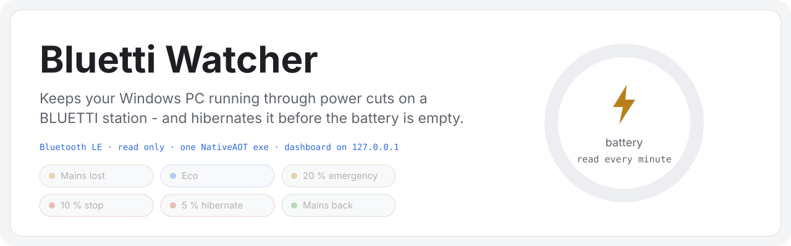
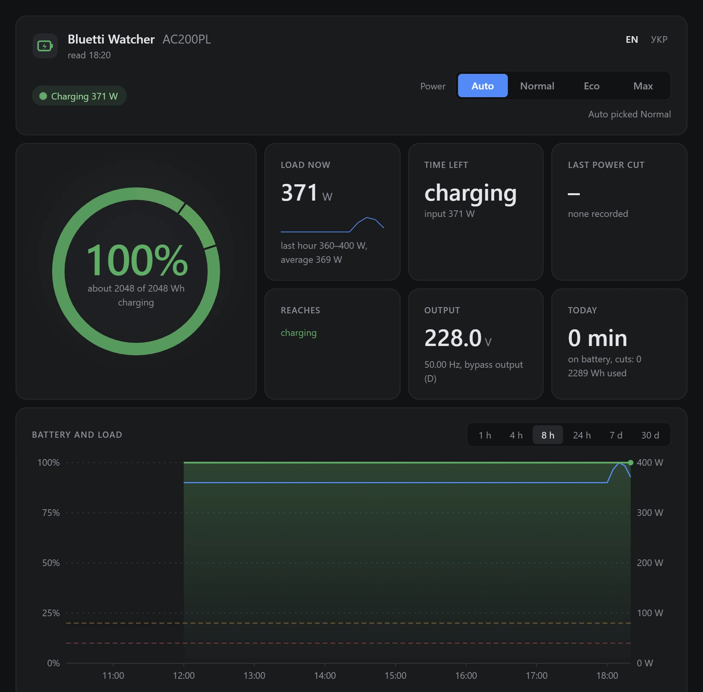
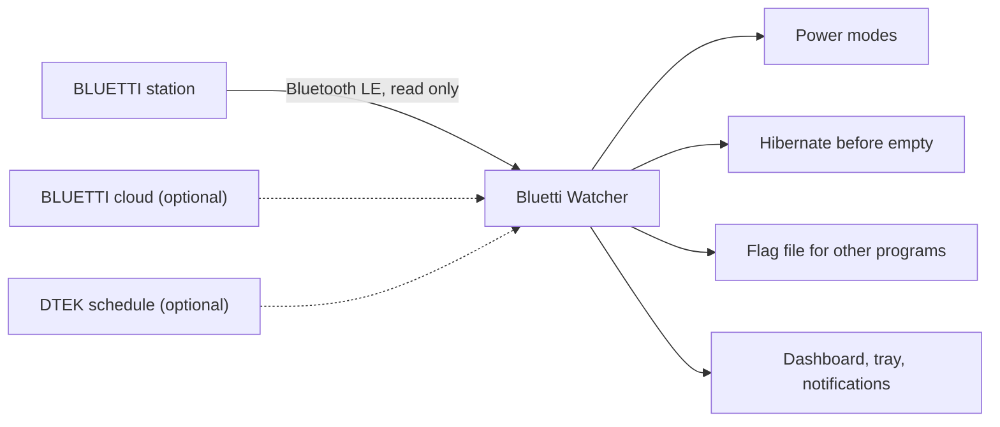
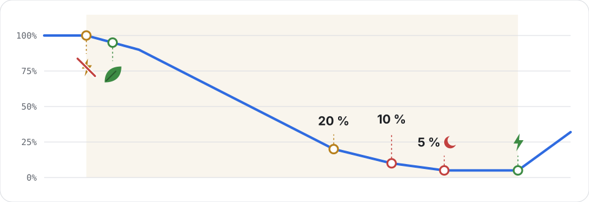
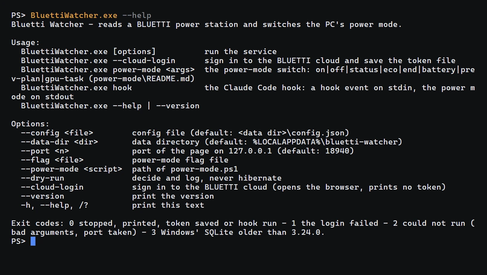
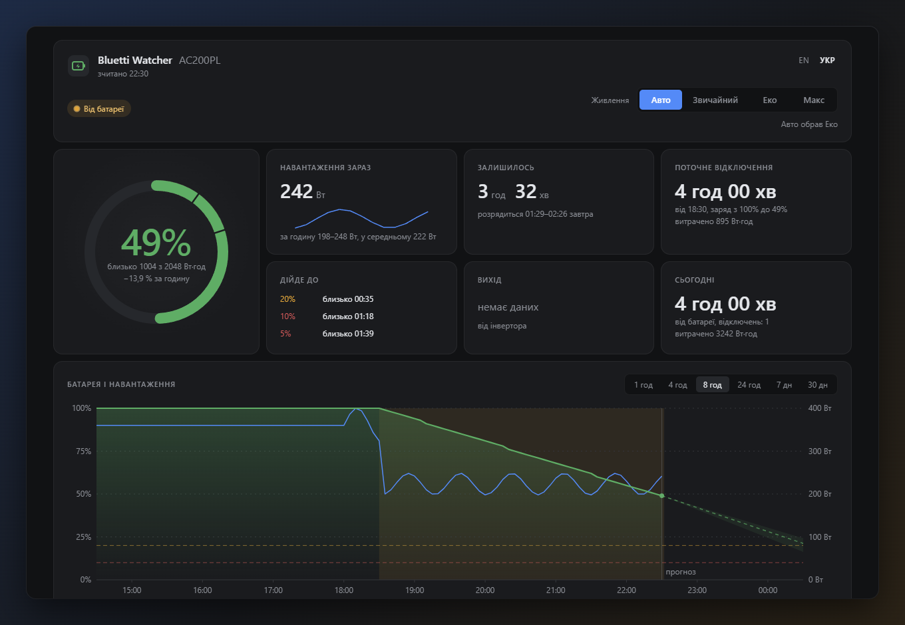
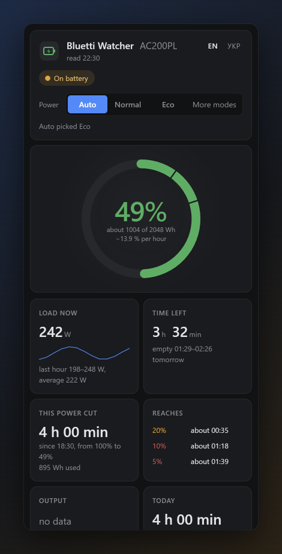

<div align="center">

<picture>
  <source media="(prefers-color-scheme: dark)" srcset="docs/media/hero-dark.svg">
  
</picture>

<h3>Keeps your Windows PC running through power cuts on a BLUETTI station, and hibernates it before the battery is empty.</h3>

<p>
  <a href="https://github.com/vitaliy-shatskiy/bluetti-watcher/actions/workflows/ci.yml"></a>
  <a href="https://github.com/vitaliy-shatskiy/bluetti-watcher/releases/latest"></a>
  
  <a href="LICENSE"></a>
</p>

<p><b>English</b> · <a href="README.uk.md">Українська</a></p>

<p><a href="#install">Install</a> · <a href="#what-happens-in-a-cut">What happens in a cut</a> · <a href="#power-modes">Power modes</a> · <a href="#supported-stations">Stations</a> · <a href="#faq">FAQ</a> · <a href="docs/configuration.md">Configuration</a></p>

</div>

```powershell
pwsh -NoProfile -File install.ps1 -Mac AA:BB:CC:DD:EE:FF -CapacityWh 2048 -Apply
```

<p align="center">
  <a href="docs/media/demo.mp4"></a>
</p>

> [!IMPORTANT]
> An independent project, not affiliated with or endorsed by BLUETTI. Download it only from
> [this repository's releases](https://github.com/vitaliy-shatskiy/bluetti-watcher/releases/latest).

A desktop on a power station dies quietly when the battery runs out. Bluetti Watcher reads the station over Bluetooth LE
once a minute. When mains is lost it switches the PC to a power-saving mode, warns at low battery and hibernates the PC
before the station is empty; when mains is back it undoes every change. A dashboard on `127.0.0.1` and a tray icon show
the battery, the load, the time left and the history.



## What you get

- **Bluetooth reader built in**: 29 BLUETTI models, read only, nothing else to install.
- **Power modes**: Normal, Eco, Max and your own, picked by Auto rules or by hand; every change undone on leaving.
- **Safe hibernation**: levels act only on two agreeing readings; implausible jumps are rejected.
- **Battery time learned from your station**: a loss model fitted to your past cuts, with a likely range.
- **Dashboard** in English and Ukrainian: battery, load, time left, cut history, charts from 1 hour to 30 days; fits a phone.
- **Tray icon and Windows notifications**: mains lost and back, a mode the program switched, low battery, failures,
  station alarms; all off with one switch.
- **Optional**: BLUETTI cloud fallback, DTEK outage schedule (Kyiv region), wake during a cut, Claude Code integration.
- **One NativeAOT exe**, a per-user scheduled task, no window, no elevation for the service.

## What happens in a cut

<picture>
  <source media="(prefers-color-scheme: dark)" srcset="docs/media/flow-dark.svg">
  
</picture>

| When (defaults) | What happens |
|---|---|
| Mains lost for 3 minutes | Auto switches to Eco: the Windows Power saver plan plus the Eco actions you turned on |
| Battery at 20 % | Emergency: the flag file tells programs that read it to wind down |
| Battery at 10 % | Stop: the flag says critical, a signal to save work and stop |
| Battery at 7 % | Hibernate warning |
| Battery at 5 % | The PC hibernates, after a fresh reading agrees |
| Mains back for 3 minutes | Auto switches back to Normal; every setting Eco changed is restored |

Every threshold is configurable ([configuration.md](docs/configuration.md#mains-and-battery-levels)). At a high measured
drain the levels are raised so the PC still hibernates in time. The rules in full: [docs/design.md](docs/design.md).

<a id="quick-start"></a>

## Install

Needs Windows 10 or 11 x64 with a Bluetooth LE adapter, PowerShell 7 (`pwsh`), and Chrome or Edge for the dashboard
shortcut. The service uses the SQLite built into Windows (`winsqlite3.dll`) and needs 3.24.0 or later; with an older one
it does not start and `service.log` names the version found.

1. Download `bluetti-watcher-<version>-win-x64.zip` and its `.sha256` from
   [the latest release](https://github.com/vitaliy-shatskiy/bluetti-watcher/releases/latest), compare the hash, extract:

   ```powershell
   (Get-FileHash .\bluetti-watcher-*-win-x64.zip).Hash   # must equal the hash in the .sha256 file
   ```

2. Find the station's Bluetooth address (the BLUETTI app or Windows Settings > Bluetooth) and its capacity in Wh (the
   spec sheet; the time left is computed from it).
3. In PowerShell 7, in the extracted folder:

   ```powershell
   pwsh -NoProfile -File install.ps1 -Mac AA:BB:CC:DD:EE:FF -CapacityWh <Wh>          # dry run: every step and what blocks it
   pwsh -NoProfile -File install.ps1 -Mac AA:BB:CC:DD:EE:FF -CapacityWh <Wh> -Apply   # install
   ```

The installer writes `%LOCALAPPDATA%\bluetti-watcher` (`bin\`, `config.json`, `station.db`, `service.log`), registers the
logon task `BluettiWatcher` (current user, not elevated), starts it and waits for `/api/health`, registers the wake task
(disabled) and adds a `Bluetti Watcher` shortcut on the Desktop and in the Start menu.

Power-mode actions that need administrator rights (services, scheduled tasks, the NVIDIA power limit and profiles) go
through the **admin broker**, a SYSTEM task that does only what its allow list names. Run the install from an elevated
PowerShell and it sets the broker up too; from a normal one it installs the service and names the elevated step left:

```powershell
pwsh -NoProfile -File install.ps1 -Broker -Apply   # elevated, in the extracted release folder
```

Without the broker the service runs fine; only the actions that need it report so.

## Using it

- **Dashboard**: the `Bluetti Watcher` shortcut, or `http://127.0.0.1:18940/`. The switch in the header picks Auto or a
  mode. The Power modes panel says what each mode does in plain words and edits modes, their actions and the Auto
  rules. The Settings card turns hibernation and notifications on or off and sends a test notification.
- **Tray icon**: the charge as digits over a bar, green on mains, amber on battery, grey with no fresh reading. The
  tooltip gives the watts, the mode and the time left; a click opens Auto, every mode, "Open panel" and "Exit tray"
  (hides the icon until the service restarts; the service keeps running).
- **Notifications**: Windows toasts for mains lost and back, a mode the program switched on its own (an Auto rule, a
  dropped choice; a mode you pick yourself shows none), low battery, failed actions, an admin broker older than the
  service, and station faults, warnings and over-temperature. "Notifications" on the Settings card turns them all off;
  "Set up" beside it switches each group; the same switches live in
  [`notifications.json`](docs/configuration.md#notifications-notificationsjson). No icon (`"tray": false` or
  `--no-tray`) means no notifications.
- **Flag file** `%ProgramData%\BluettiWatcher\power-mode.json`: the current mode and battery level for other programs
  ([power-mode/README.md](power-mode/README.md)).
- **Command line**: `BluettiWatcher.exe --help`, `--version`, `power-mode status`
  ([all commands](docs/configuration.md#command-line)).

<p align="center">
  <a href="docs/demos/cli.mp4"></a>
</p>

| Ukrainian, desktop | English, phone |
|---|---|
|  |  |

## Power modes

A power mode is a named list of actions applied to this PC. Normal, Eco and Max are built in; add your own on the page
or through the [API](docs/api.md#power-modes-modesengine--v2). **Auto** picks a mode by rules checked in order: mains
off or on for some time, battery under a level, a planned outage within some minutes (DTEK module), a time window. A
mode you pick by hand holds until you choose Auto again.

The actions a mode can hold:

- the power plan, the processor's maximum state and boost, the display-off timeout;
- the display refresh rate and brightness;
- the NVIDIA GPU power limit and driver profile;
- services and scheduled tasks;
- apps and Phone Link closed;
- a command pair from `config.json` (for example pause a backup on entering, resume it on leaving);
- the RGB lighting off through [OpenRGB](https://openrgb.org/), a profile of your choice back on leaving.

The GPU limit and profile, services, scheduled tasks that refuse the user and elevated apps go through the admin broker,
which acts only on what its allow list names (`BluettiWatcher.exe --broker-allow`, elevated).

Every change is journaled and undone when the mode is left, unless you changed that setting by hand in the meantime:
then it stays as you set it. The built-in Normal sets the Balanced plan, Eco the Power saver plan with the other
actions listed and switched off, Max the High performance plan. A saved mode is never rewritten by an update.
`"modes": { "engine": "legacy" }` keeps the older fixed eco ([configuration.md](docs/configuration.md#power-mode-and-actions)).

## Supported stations

| Family | Models | Over Bluetooth |
|---|---|---|
| IoT V1 | AC200PL (tested), AC200L, AC200M, AC300, AC500, EB3A, EP500, EP500P | yes |
| IoT V2 | AC2A, AC2P, AC50B, AC60, AC60P, AC70, AC70P, AC180, AC180T, AC180P, AP300, EL10, EL30V2, EL100V2, Handsfree 1, PR30V2, PR100V2 | yes |
| IoT V2, battery level only | EP600, EP760, EP800, EP2000 | no: Bluetooth cannot tell mains from battery there, the cloud fallback reads them |

Set `type` in `config.json` to your model. Only the AC200PL is tested on hardware. A station that encrypts its
Bluetooth link is detected (`/api/health` shows `bluetoothEncrypted: true`), not connected to again until the service
restarts, and read through the cloud fallback if it is on. Register maps: [docs/bluetti-protocol.md](docs/bluetti-protocol.md).
A report helps: [station support](https://github.com/vitaliy-shatskiy/bluetti-watcher/issues/new?template=station_support.yml).

## Optional modules

- **Cloud fallback** (unofficial, read only): when Bluetooth does not answer, the reading comes from the BLUETTI cloud's
  live state, and gaps in the history are filled from its 5-minute history. Sign in on the dashboard ("Sign in to
  BLUETTI cloud") or once with `BluettiWatcher.exe --cloud-login`. The Reading source buttons pick Auto (Bluetooth, then
  the cloud), Bluetooth only or Cloud only. It may stop working if BLUETTI changes its API.
  [Details](docs/design.md#4-cloud-fallback).
- **DTEK module** (Kyiv region, off by default): the next planned outage for your queue, an hour grid for today and
  tomorrow checked against the station's own mains reading, and whether the battery lasts. Enable with
  `"dtekWatcher": { "enabled": true, "queues": ["GPV1.1"] }`. [Details](docs/design.md#11-dtek-module-planned-outages-kyiv-region).
- **Wake during a cut** (off by default): a PC hibernated in a cut wakes every `wakeEveryMinutes` to check whether mains
  is back; never near an empty battery. Run the check below once before turning it on.
  [Details](docs/design.md#8-wake-during-a-cut).
- **Claude Code integration**: `BluettiWatcher.exe hook` tells each Claude Code session the power mode and battery level,
  so it saves work and avoids heavy jobs during a cut. [integrations/claude-code](integrations/claude-code/README.md).

<details>
<summary>Wake check: run once before setting <code>wakeEveryMinutes</code></summary>

From a normal (not elevated) PowerShell after the install:

```powershell
$t = Get-ScheduledTask -TaskName BluettiWatcherWake; $t.Triggers[0].StartBoundary = (Get-Date).AddMinutes(4).ToString('s'); $t.Triggers[0].Enabled = $true; $t.Settings.Enabled = $true; Set-ScheduledTask -InputObject $t | Out-Null; powercfg /waketimers; shutdown /h
```

`powercfg /waketimers` must list the task before the PC goes down, and the PC must come back by itself about 4 minutes
later (`powercfg /lastwake` names the source; `Disable-ScheduledTask -TaskName BluettiWatcherWake` turns it off). If it
does not wake, RTC wake from hibernation is off in the firmware or "Allow wake timers" is off in the power plan. If it
does: set `"wakeEveryMinutes": 45` in `config.json` and restart the task.

</details>

## Safety and privacy

- **Read only toward the station.** The Bluetooth reader builds one kind of request, a Modbus read (function 0x03), and
  writes nothing but that request and its notification subscription. The cloud client has no control call.
- **Local only.** The HTTP API listens on `127.0.0.1` and refuses any `Host` other than `127.0.0.1:<port>` or
  `localhost:<port>`. Every write route needs the header `X-Station: 1` and no foreign `Origin`, which other web
  pages cannot send ([api.md](docs/api.md#request-rules)).
- **Off switches.** "Hibernate on low battery" on the Settings card stops hibernation. `--dry-run` or `"dryRun": true` logs
  every power-mode command and hibernation instead of running it.
- **Nothing leaves the PC** unless you turn on a module:
  - Cloud fallback: `sso.bluettipower.com` (sign-in, token refresh) and `gw.bluettipower.com` (device list, live state,
    at most 40 history reads a day). The token stays in the data directory and is never logged.
  - DTEK module: the public dataset on `raw.githubusercontent.com`; with `"site": true` also the distributor's website,
    subject to its terms, which gets your address only if you set `city`, `street` and `house`.

Reporting a vulnerability: [SECURITY.md](SECURITY.md).

## FAQ

<details>
<summary><b>Windows warns about the download, or PowerShell refuses <code>install.ps1</code> as not signed.</b></summary>

The release is not code-signed. Compare `(Get-FileHash <zip>).Hash` with the `.sha256` file from the same release, then
unblock the extracted folder: `Get-ChildItem -Recurse | Unblock-File`.

</details>

<details>
<summary><b>Does it change any setting on the station?</b></summary>

No. Bluetooth sends only read requests and the cloud client has no control call.

</details>

<details>
<summary><b>Bluetooth does not answer.</b></summary>

Keep the station in range and close the BLUETTI app on your phone, which may hold the connection. `service.log` names
the first miss, the turn to "station silent", every 15th miss after it, and the step a slow open hung in. The cloud
fallback covers the gaps.

</details>

<details>
<summary><b>How do I stop a hibernation right now?</b></summary>

Switch off "Hibernate on low battery" on the Settings card; it applies at once. With the legacy engine, create an empty file
`no-hibernate` in `%LOCALAPPDATA%\bluetti-watcher` instead.

</details>

<details>
<summary><b>Task Manager shows the service at almost no memory. Is that real?</b></summary>

Partly. After each poll the service hands its pages back to Windows (`trimWorkingSet`, on by default), so the "Memory"
column (private working set) stays small; the committed memory does not change and the pages come back at the next
poll. `"trimWorkingSet": false` turns it off.

</details>

<details>
<summary><b>Other brands (EcoFlow, Jackery, ...)?</b></summary>

No. The reader speaks the BLUETTI protocol only.

</details>

## Configuration

`%LOCALAPPDATA%\bluetti-watcher\config.json`; only `mac` is required. Every key and its default:
[docs/configuration.md](docs/configuration.md). The HTTP API: [docs/api.md](docs/api.md). Restart the task after an edit:

```powershell
Stop-ScheduledTask BluettiWatcher; Start-ScheduledTask BluettiWatcher
```

## Update and uninstall

To update, run `install.ps1 -Apply` from the new release's folder. `config.json`, the history and the cloud token stay;
the new exe is swapped in within seconds, and a failed health check puts the previous one back. With the admin broker,
also run `install.ps1 -Broker -Apply` from an elevated PowerShell: the broker runs its own copy of the exe, and
`/api/health` and the tray say when that step is due. What changed: [CHANGELOG.md](CHANGELOG.md).

<details>
<summary>Uninstall</summary>

On mains, in this order:

1. On the dashboard pick **Normal** in the header's power switch, so every change a mode made is restored.
2. Stop the service and remove its tasks and files:

```powershell
Disable-ScheduledTask -TaskName BluettiWatcher | Out-Null
Stop-ScheduledTask -TaskName BluettiWatcher
Get-Process BluettiWatcher, BluettiWatcherService -ErrorAction SilentlyContinue | Wait-Process -Timeout 30
pwsh -NoProfile -File "$env:LOCALAPPDATA\bluetti-watcher\power-mode\power-mode.ps1" off   # resets the flag; legacy engine: restores its eco
Unregister-ScheduledTask -TaskName BluettiWatcher -Confirm:$false
pwsh -NoProfile -File install.ps1 -RemoveWake -Apply                                    # from the release folder
Remove-Item -Recurse "$env:LOCALAPPDATA\bluetti-watcher", "$env:ProgramData\BluettiWatcher"
```

3. With the admin broker or the legacy GPU tasks, from an elevated PowerShell:

```powershell
Unregister-ScheduledTask -TaskName BluettiWatcherBroker -Confirm:$false -ErrorAction SilentlyContinue
Get-ScheduledTask -TaskName 'BluettiWatcherEco*' -ErrorAction SilentlyContinue | Unregister-ScheduledTask -Confirm:$false
Remove-Item -Recurse "$env:ProgramFiles\BluettiWatcher", "$env:ProgramData\BluettiWatcherBroker" -ErrorAction SilentlyContinue
```

4. Delete the `Bluetti Watcher` shortcuts.

`power-mode.ps1 off` prints `power mode: normal` and one line per thing it put back; a line starting with `warn:` or
`note:` means something is still owed, so run it again. With non-default `powerMode` names in `config.json`, set
`POWER_MODE_FILE`, `POWER_MODE_MUTEX` and `POWER_MODE_TASK_PREFIX` first
([power-mode README](power-mode/README.md#configuration)).

</details>

## Build from source

```powershell
git clone https://github.com/vitaliy-shatskiy/bluetti-watcher.git
cd bluetti-watcher
pwsh -NoProfile -File install.ps1 -Mac AA:BB:CC:DD:EE:FF -CapacityWh <Wh> -Apply   # publishes NativeAOT, then installs
```

Needs the .NET SDK named in `global.json` and, for NativeAOT, the MSVC linker (Visual Studio Build Tools, "Desktop
development with C++"); `-Fallback` builds a trimmed single-file exe without it. Tests and development:
[CONTRIBUTING.md](CONTRIBUTING.md).

---

[Contributing](CONTRIBUTING.md) · [Security](SECURITY.md) · [Changelog](CHANGELOG.md)

MIT, see [LICENSE](LICENSE). Not affiliated with or endorsed by BLUETTI.
