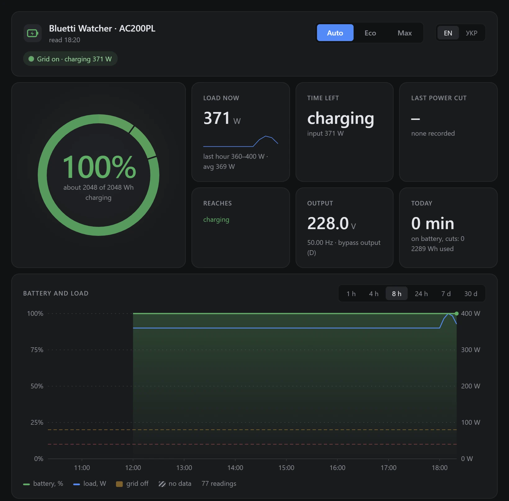
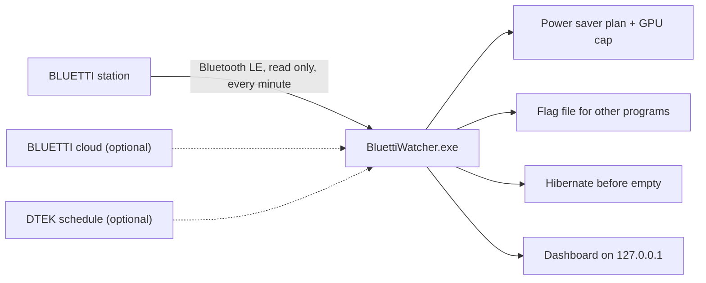
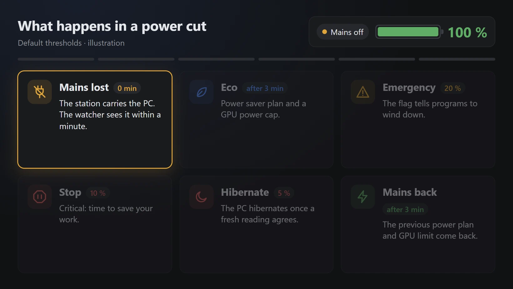
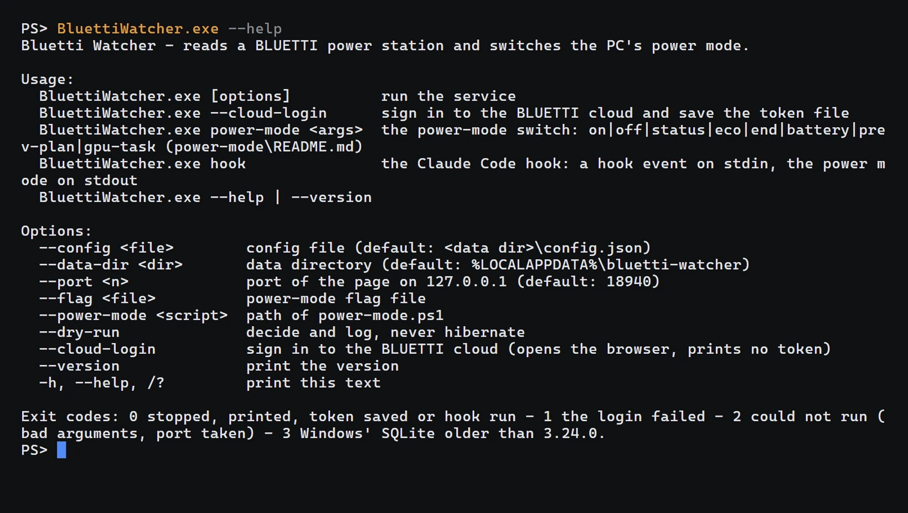

<div align="center">

<picture>
  <source media="(prefers-color-scheme: dark)" srcset="docs/media/hero-dark.svg">
  
</picture>

<h3>Keeps your Windows PC running through power cuts on a BLUETTI station, and hibernates it before the battery is empty.</h3>

<p>
  <a href="https://github.com/vitaliy-shatskiy/bluetti-watcher/actions/workflows/ci.yml"></a>
  <a href="https://github.com/vitaliy-shatskiy/bluetti-watcher/releases/latest"></a>
  
  <a href="LICENSE"></a>
</p>

<p><b>English</b> · <a href="README.uk.md">Українська</a></p>

<p><a href="#quick-start">Install</a> · <a href="#how-it-works">How it works</a> · <a href="#features">Features</a> · <a href="#supported-hardware">Hardware</a> · <a href="#faq">FAQ</a> · <a href="docs/configuration.md">Configuration</a></p>

</div>

```powershell
pwsh -NoProfile -File install.ps1 -Mac AA:BB:CC:DD:EE:FF -CapacityWh 2048 -Apply   # in the extracted release folder
```

<p align="center">
  <a href="docs/media/demo.mp4"></a>
  <br>
  <sub>The real dashboard (station.html) on demo readings through a simulated cut: about seven hours shown in 28 seconds. Recorded 28.10.2026 by <code>docs/media/record-demo.mjs</code>. <a href="docs/media/demo.mp4">MP4</a>.</sub>
</p>

> [!IMPORTANT]
> An independent project, not affiliated with or endorsed by BLUETTI. Download it only from
> [this repository's releases](https://github.com/vitaliy-shatskiy/bluetti-watcher/releases/latest).

In Ukraine scheduled and emergency outages are routine, and a desktop on a power station dies quietly when the battery
runs out. Bluetti Watcher reads the station once a minute over Bluetooth LE and, when mains is lost, switches the PC
to an energy-saving mode, raises an emergency at low battery and hibernates the PC before the station is empty. When
mains comes back it puts everything back, and a small dashboard on `127.0.0.1` shows the battery, the load, the time
left and the history.

## How it works



<p align="center">
  <a href="docs/media/explainer/explainer.mp4"></a>
  <br>
  <sub>Illustration, default thresholds. Drawn by <code>docs/media/explainer/render.mjs</code>. <a href="docs/media/explainer/explainer.mp4">MP4</a>.</sub>
</p>

## How it reacts

<picture>
  <source media="(prefers-color-scheme: dark)" srcset="docs/media/flow-dark.svg">
  
</picture>
<p align="center"><sub>Illustration, default thresholds: mains lost, eco, 20 %, 10 %, 5 % hibernate, mains back.</sub></p>

| When | What happens |
|---|---|
| Mains lost for 3 minutes | Eco: the Windows Power saver plan, a GPU power cap on NVIDIA cards (if set up), the flag says eco |
| Battery at 20 % | Emergency: the flag tells programs that read it to wind down |
| Battery at 10 % | Stop: the flag's level says critical, a signal to save work and stop |
| Battery at 7 % | Hibernate warning |
| Battery at 5 % | The PC hibernates, after a fresh reading agrees |
| Mains back for 3 minutes | Every mode lifted, the previous power plan back |

Every threshold is configurable. A level acts only after two agreeing readings; the full rules are in
[docs/design.md](docs/design.md).

## Quick start

Needs Windows 10 or 11 x64 with a Bluetooth LE adapter, PowerShell 7 (`pwsh`) and Chrome or Edge. The service uses
the SQLite built into Windows (`winsqlite3.dll`) and needs version 3.24.0 or later: with an older one it does not start,
and `service.log` names the version found.

1. Download `bluetti-watcher-<version>-win-x64.zip` and its `.sha256` from
   [the latest release](https://github.com/vitaliy-shatskiy/bluetti-watcher/releases/latest), check the hash and
   extract the zip:

   ```powershell
   (Get-FileHash .\bluetti-watcher-*-win-x64.zip).Hash   # must equal the hash in the .sha256 file
   ```

2. Find the station's Bluetooth address (the BLUETTI app, or Windows Settings > Bluetooth) and its battery capacity in Wh
   (the spec sheet or the label; the battery time is computed from it).
3. In PowerShell 7, in the extracted folder:

   ```powershell
   pwsh -NoProfile -File install.ps1 -Mac AA:BB:CC:DD:EE:FF -CapacityWh <Wh>          # dry run: prints every step and what blocks it
   pwsh -NoProfile -File install.ps1 -Mac AA:BB:CC:DD:EE:FF -CapacityWh <Wh> -Apply   # install
   ```

Everything lands in `%LOCALAPPDATA%\bluetti-watcher` (`bin\`, `power-mode\`, `config.json`, `station.db`,
`service.log`). The installer registers the logon task `BluettiWatcher` (current user, no elevation), starts it, waits
for `/api/health`, registers the wake task (disabled) and creates the `Bluetti Watcher` shortcut on the Desktop and in
the Start menu.

Optional, once, from an elevated PowerShell: the GPU power cap during eco on NVIDIA cards needs two scheduled tasks
that only an administrator can register:

```powershell
pwsh -NoProfile -File "$env:LOCALAPPDATA\bluetti-watcher\power-mode\power-mode.ps1" gpu-task install
```

## Features

- Reads the station over Bluetooth LE, read only; optional fallback to the BLUETTI cloud when Bluetooth is silent.
- Built-in Bluetooth reader, nothing else to install: all 29 supported models, IoT V1 (AC200L/M/PL, AC300, AC500, EB3A, EP500/P) and V2 (AC2A/P, AC50B, AC60/P, AC70/P, AC180/T/P, AP300, EL10, EL30V2, EL100V2, EP600, EP760, EP800, EP2000, Handsfree 1, PR30V2, PR100V2); a station that encrypts its Bluetooth link is read through the cloud fallback.
- Eco, emergency, stop, hibernate warning and hibernation by mains state and battery level, all thresholds configurable.
- Guards against bad readings: implausible jumps rejected, a longer confirmation after the station recalibrates.
- AC200PL grid input voltage (register 77, [protocol notes](docs/bluetti-protocol.md)) stored with every reading: above
  253 V one alert and your configured action, so an over-voltage on the input leaves a trace.
- Dashboard in English and Ukrainian: battery ring coloured by your levels, time left, power cuts, battery stats for 30 days,
  charts from 1 hour to 30 days. Fits a phone, a Full HD and a 2K screen.
- Battery time learned from your own station: a loss model (idle draw plus a share of the load) fitted to past cuts, the
  eco-mode saving counted early in a cut, and a likely range once 5 cuts are recorded (`fittedRuntime`, on by default).
- Manual control on the page: Auto, Eco, Max.
- Your own command when a mode begins (`actions`), and a flag file other programs can read.
- Optional wake timer and DTEK planned-outage schedule (Kyiv region): an hour grid for today and tomorrow, checked against the station's own mains reading, and the hours already past show whether there really was power.
- One NativeAOT exe, a per-user scheduled task, no window and no tray.

## Screenshots

| Ukrainian, desktop | English, phone |
|---|---|
|  |  |

<sub>Demo readings, four hours into a simulated cut. Captured by <code>docs/media/capture-screens.mjs</code>.</sub>

## Supported hardware

- BLUETTI AC200PL: tested.
- The other IoT V1 models, read over Bluetooth the same way (set `type` in the configuration): AC200L, AC200M, AC300,
  AC500, EB3A, EP500, EP500P; untested. The AC300 gives the full reading (battery, AC and DC power, output mode,
  inverter voltage and frequency); its battery packs are not read.
- The IoT V2 models, read over Bluetooth too (set `type`): AC2A, AC2P, AC50B, AC60, AC60P, AC70, AC70P, AC180, AC180T,
  AC180P, AP300, EL10, EL30V2, EL100V2, EP600, EP760, EP800, EP2000, Handsfree 1, PR30V2, PR100V2; untested. The EP600,
  EP760, EP800 and EP2000 report the battery level only over Bluetooth, which cannot tell mains from battery: they are not
  read over Bluetooth, and the cloud fallback answers (one log line says so). A station that encrypts its Bluetooth link
  (it opens with a key exchange) is not read over Bluetooth, and not connected to again until the service restarts (`/api/health` shows `bluetoothEncrypted: true`); with the cloud fallback on ([Optional modules](#optional-modules)) the cloud
  answers instead: battery, AC input and AC output.

A report helps: [station support](https://github.com/vitaliy-shatskiy/bluetti-watcher/issues/new?template=station_support.yml).

Bluetti Watcher is an independent project, not affiliated with or endorsed by BLUETTI.

## Safety and privacy

- Read only toward the station: the Bluetooth reader can build one kind of request, a read (Modbus function 0x03)
  under the control registers, and writes nothing else but that request and its notification subscription. No
  setting on the station is ever changed.
- The HTTP API listens on `127.0.0.1` only and refuses any request whose `Host` is not `127.0.0.1:<port>` or
  `localhost:<port>`. The one write route (`POST /api/mode`) needs a custom header that other web pages cannot send.
- Kill switch: an empty file `no-hibernate` in `%LOCALAPPDATA%\bluetti-watcher` turns hibernation off, checked on
  every poll. A dry run (`--dry-run` or `"dryRun": true`) logs every power-mode command and hibernation instead.
- Nothing leaves the PC unless you turn on one of two modules:
  - Cloud fallback: the token refresh to `sso.bluettipower.com` and the device-list read from `gw.bluettipower.com`,
    plus at most 40 reads a day of the station's power curve there to fill gaps in the history (`cloudHistory`).
    The token stays in the data directory and is never logged.
  - DTEK module: reads the public dataset on `raw.githubusercontent.com`. Only with `"site": true` it also reads the
    distributor's site (`www.dtek-krem.com.ua`) as a browser would, subject to the site's terms; your address goes
    there only if you set `city`, `street` and `house`.

Reporting a vulnerability: [SECURITY.md](SECURITY.md).

## Optional modules

- **Wake during a cut** (off by default): a PC hibernated in a cut wakes every `wakeEveryMinutes` to check whether
  mains is back; no wake is armed near an empty battery. Run the check below once before turning it on.
  Rules: [docs/design.md](docs/design.md#8-wake-during-a-cut).
- **DTEK module** (Kyiv region, off by default): the next planned outage for your queue, the expected return and
  whether the battery lasts. It never changes a power-mode decision.
  `"dtekWatcher": { "enabled": true, "queues": ["GPV1.1"] }` (add `"site": true` to also read the distributor's website: faster plan edits, subject to its terms); details:
  [docs/design.md](docs/design.md#11-dtek-module-planned-outages-kyiv-region).
- **Cloud fallback** (unofficial, read only): when Bluetooth does not answer, the reading comes from the BLUETTI cloud.
  Sign in once with `& "$env:LOCALAPPDATA\bluetti-watcher\bin\BluettiWatcher.exe" --cloud-login`; it may stop working
  if BLUETTI changes its API. Details: [docs/design.md](docs/design.md#4-cloud-fallback).
- **Claude Code integration**: `BluettiWatcher.exe hook` tells each Claude Code session on the PC the power mode and battery
  level, so sessions save work and avoid heavy jobs during a cut; no Node.js needed: [integrations/claude-code](integrations/claude-code/README.md).

<details>
<summary>Wake check: run once before setting <code>wakeEveryMinutes</code></summary>

From a normal (not elevated) PowerShell after the install:

```powershell
$t = Get-ScheduledTask -TaskName BluettiWatcherWake; $t.Triggers[0].StartBoundary = (Get-Date).AddMinutes(4).ToString('s'); $t.Triggers[0].Enabled = $true; $t.Settings.Enabled = $true; Set-ScheduledTask -InputObject $t | Out-Null; powercfg /waketimers; shutdown /h
```

`powercfg /waketimers` must list the task before the PC goes down, and the PC must come back by itself about 4 minutes
later (`powercfg /lastwake` names the source; `Disable-ScheduledTask -TaskName BluettiWatcherWake` turns it off). If it
does not wake, RTC wake from hibernation is off in the firmware or "Allow wake timers" is off in the power plan. If it
does: `"wakeEveryMinutes": 45` in `config.json` and a restart of the task. `install.ps1 -RemoveWake -Apply` removes
the wake task.

</details>

## FAQ

**Windows warns about the download, or PowerShell refuses `install.ps1` as not digitally signed.**
The release is not code-signed. Compare `(Get-FileHash <zip>).Hash` with the `.sha256` file from the same release, then
unblock the extracted folder: `Get-ChildItem -Recurse | Unblock-File`.

**Does it change any setting on the station?**
No. It only reads; the Bluetooth reader can send nothing but read requests, and the cloud client never sends a
control command.

**My station is not an AC200PL.**
Set `type` to your model. All 29 models (IoT V1 and V2) are read over Bluetooth; an encrypted station, or a model not in the list, only through the cloud fallback
([Supported hardware](#supported-hardware)). Please open a [station support](https://github.com/vitaliy-shatskiy/bluetti-watcher/issues/new?template=station_support.yml)
issue either way.

**Bluetooth does not answer.**
Keep the station in range and close the BLUETTI app on your phone, which may hold the connection. `service.log` in the
data directory names the first miss, the turn to "station silent" and every 15th miss after it; the cloud fallback
covers the gaps.

**How do I stop a hibernation right now?**
`New-Item "$env:LOCALAPPDATA\bluetti-watcher\no-hibernate"`. It is checked on every poll; delete the file to turn
hibernation back on.

**Task Manager shows the service at about 1 to 2 MB of memory. Is that real?**
Partly. After each poll the service hands its pages back to Windows (`trimWorkingSet`, on by default), so the "Memory"
column (private working set) stays at about 1 to 2 MB while Bluetooth is read (under 1 MB without it); an open page
raises it again until the next poll. The memory it has committed (private bytes, about 5 to 8 MB) does not change,
and the pages fault back in at the next poll. `"trimWorkingSet": false` in config.json turns it off.

**Other brands (EcoFlow, Jackery, ...)?**
No. The reader speaks the BLUETTI protocol only.

## Install from source

```powershell
git clone https://github.com/vitaliy-shatskiy/bluetti-watcher.git
cd bluetti-watcher
pwsh -NoProfile -File install.ps1 -Mac AA:BB:CC:DD:EE:FF -CapacityWh <Wh>          # dry run
pwsh -NoProfile -File install.ps1 -Mac AA:BB:CC:DD:EE:FF -CapacityWh <Wh> -Apply   # publishes NativeAOT, then installs as above
```

Needs the .NET SDK named in `global.json` and, for NativeAOT, the MSVC linker (Visual Studio Build Tools, "Desktop
development with C++"); `-Fallback` builds a trimmed single-file exe without it. Development without installing:
[CONTRIBUTING.md](CONTRIBUTING.md).

## Configuration

`%LOCALAPPDATA%\bluetti-watcher\config.json`; only `mac` is required. Every key, its default and an example:
[docs/configuration.md](docs/configuration.md). The rules the service follows: [docs/design.md](docs/design.md). The
HTTP API: [docs/api.md](docs/api.md). Restart the task after an edit:

```powershell
Stop-ScheduledTask BluettiWatcher; Start-ScheduledTask BluettiWatcher
```

The command line: `--help`, `--version` and the power-mode switch (`power-mode status` only reads the flag).

<p align="center">
  <a href="docs/demos/cli.mp4"></a>
  <br>
  <sub>Recorded 28.10.2026 with VHS by <code>docs/demos/cli.tape</code>: read-only commands, a demo flag file. <a href="docs/demos/cli.mp4">MP4</a>.</sub>
</p>

## Update and uninstall

To update, run `install.ps1 -Apply` from the new release's folder. `config.json`, the history and the cloud token stay;
the new exe is staged next to the running one and swapped in seconds, and a failed health check puts the previous
version back. What changed: [CHANGELOG.md](CHANGELOG.md).

<details>
<summary>Uninstall</summary>

In this order (the task restarts the exe after any exit until it is disabled, and a running service would set eco
again; `power-mode.ps1` and the GPU task removal need the data directory's scripts, so they run before it is deleted):

```powershell
# 1. stop the service and wait until the exe has exited
Disable-ScheduledTask -TaskName BluettiWatcher | Out-Null
Stop-ScheduledTask -TaskName BluettiWatcher
Get-Process BluettiWatcher -ErrorAction SilentlyContinue | Wait-Process -Timeout 30

# 2. leave eco: puts back the power plan and the GPU power limit eco changed and removes the eco end task
pwsh -NoProfile -File "$env:LOCALAPPDATA\bluetti-watcher\power-mode\power-mode.ps1" off

# 3. only if the GPU tasks were installed: from an elevated PowerShell
pwsh -NoProfile -File "$env:LOCALAPPDATA\bluetti-watcher\power-mode\power-mode.ps1" gpu-task remove

# 4. unregister the tasks (the end task is already gone after step 2; this clears a leftover)
Unregister-ScheduledTask -TaskName BluettiWatcher -Confirm:$false
Unregister-ScheduledTask -TaskName BluettiWatcherEcoEnd -Confirm:$false -ErrorAction SilentlyContinue
pwsh -NoProfile -File install.ps1 -RemoveWake -Apply

# 5. delete the files
Remove-Item -Recurse "$env:LOCALAPPDATA\bluetti-watcher", "$env:ProgramData\BluettiWatcher"
```

Step 2 prints `power mode: normal` and one line per thing it put back, for example `plan: High performance` and
`gpu: power limit back to <W> W`; a line starting with `warn:` or `note:` means something stayed owed, so run it again
before going on. When `config.json` sets `powerMode` names other than the defaults, set `POWER_MODE_FILE`,
`POWER_MODE_MUTEX` and `POWER_MODE_TASK_PREFIX` to them first (and use `<taskPrefix>End` in step 4); the
[power-mode README](power-mode/README.md#configuration) lists them.

Then delete the `Bluetti Watcher` shortcuts.

</details>

---

[Contributing](CONTRIBUTING.md) · [Security](SECURITY.md) · [Changelog](CHANGELOG.md)

MIT, see [LICENSE](LICENSE). Not affiliated with or endorsed by BLUETTI.
