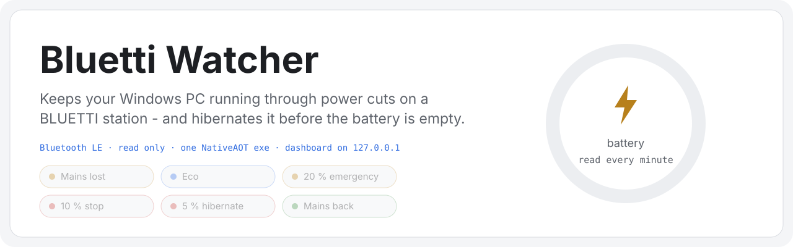
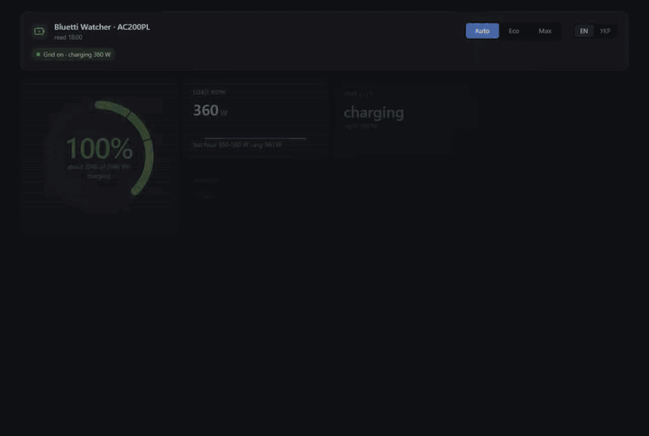
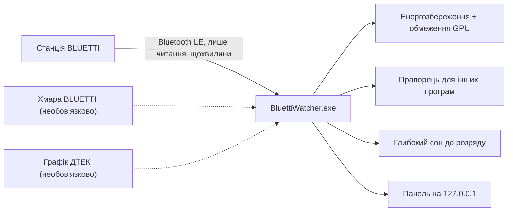
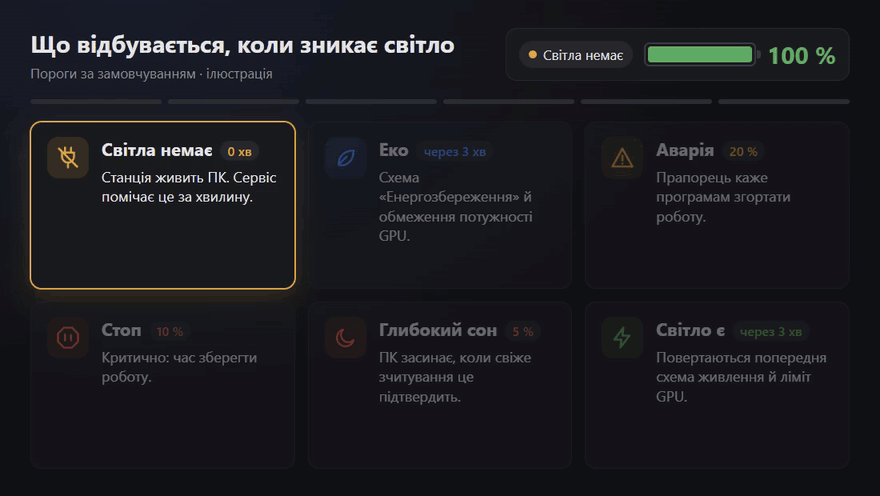
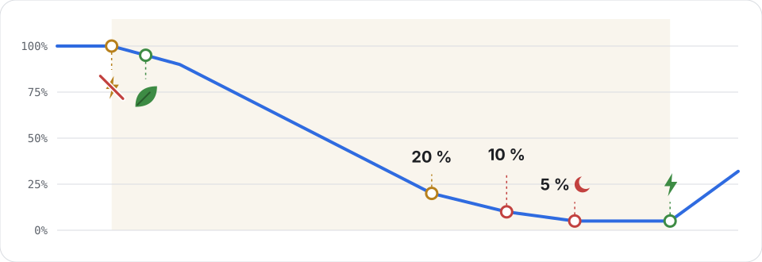
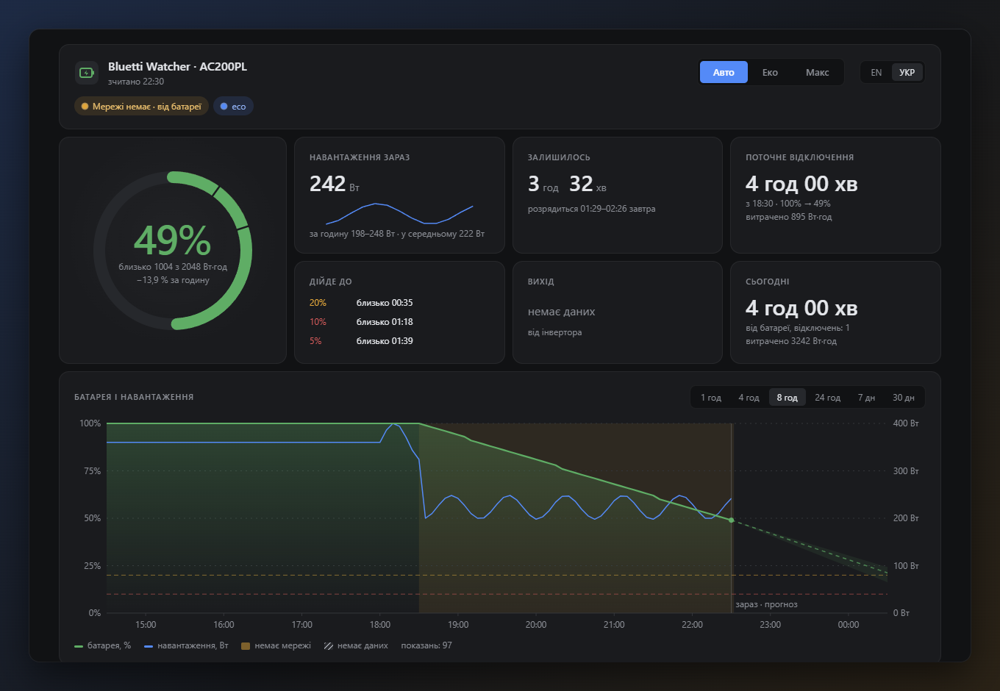
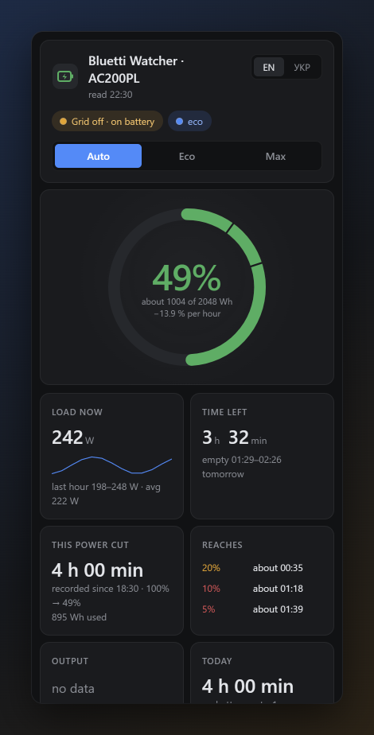

<div align="center">

<picture>
  <source media="(prefers-color-scheme: dark)" srcset="docs/media/hero-dark.svg">
  
</picture>

<h3>Тримає ваш комп'ютер на Windows увімкненим під час відключень світла від станції BLUETTI і переводить його в глибокий сон, поки батарея не сіла.</h3>

<p>
  <a href="https://github.com/vitaliy-shatskiy/bluetti-watcher/actions/workflows/ci.yml"></a>
  <a href="https://github.com/vitaliy-shatskiy/bluetti-watcher/releases/latest"></a>
  
  <a href="LICENSE"></a>
</p>

<p><a href="README.md">English</a> · <b>Українська</b></p>

<p><a href="#швидкий-старт">Встановлення</a> · <a href="#як-це-працює">Як це працює</a> · <a href="#можливості">Можливості</a> · <a href="#підтримуване-обладнання">Обладнання</a> · <a href="#часті-запитання">Запитання</a> · <a href="docs/configuration.md">Налаштування</a></p>

</div>

```powershell
pwsh -NoProfile -File install.ps1 -Mac AA:BB:CC:DD:EE:FF -CapacityWh 2048 -Apply   # у розпакованій теці релізу
```

<p align="center">
  <a href="docs/media/demo.mp4"></a>
  <br>
  <sub>Справжня панель (station.html) на демонстраційних даних під час змодельованого відключення: близько семи годин за 28 секунд. Записано 28.10.2026 скриптом <code>docs/media/record-demo.mjs</code>. <a href="docs/media/demo.mp4">MP4</a>.</sub>
</p>

> [!IMPORTANT]
> Незалежний проєкт, не пов'язаний з BLUETTI і не схвалений нею. Завантажуйте його лише з
> [релізів цього репозиторію](https://github.com/vitaliy-shatskiy/bluetti-watcher/releases/latest).

В Україні планові й аварійні відключення - буденність, а стаціонарний комп'ютер на зарядній станції просто тихо
вимикається, коли батарея сідає. Bluetti Watcher щохвилини зчитує станцію через Bluetooth LE: коли зникає світло, він
перемикає комп'ютер в енергоощадний режим, на низькому заряді вмикає аварійний, а перед тим як станція розрядиться,
переводить комп'ютер у глибокий сон. Коли світло повертається, усе стає як було, а невелика панель на `127.0.0.1`
показує заряд, навантаження, скільки ще вистачить і історію.

## Як це працює



<p align="center">
  <a href="docs/media/explainer/explainer-uk.mp4"></a>
  <br>
  <sub>Ілюстрація, пороги за замовчуванням. Намальовано скриптом <code>docs/media/explainer/render.mjs</code>. <a href="docs/media/explainer/explainer-uk.mp4">MP4</a>.</sub>
</p>

## Як він реагує

<picture>
  <source media="(prefers-color-scheme: dark)" srcset="docs/media/flow-dark.svg">
  
</picture>
<p align="center"><sub>Ілюстрація, пороги за замовчуванням: світла немає, еко, 20 %, 10 %, 5 % глибокий сон, світло є.</sub></p>

| Коли | Що відбувається |
|---|---|
| Світла немає 3 хвилини | Еко: схема живлення Windows «Енергозбереження», обмеження потужності відеокарти NVIDIA (якщо налаштовано), прапорець каже «eco» |
| Заряд 20 % | Аварійний режим: прапорець каже програмам, що його читають, згортати роботу |
| Заряд 10 % | Стоп: рівень у прапорці - critical, сигнал зберегти роботу й зупинитися |
| Заряд 7 % | Попередження про глибокий сон |
| Заряд 5 % | Комп'ютер іде в глибокий сон, коли свіже зчитування це підтверджує |
| Світло є 3 хвилини | Усі режими знято, повернуто попередню схему живлення |

Усі пороги налаштовуються. Рівень спрацьовує лише після двох узгоджених зчитувань; повні правила - у
[docs/design.md](docs/design.md) (англійською).

## Швидкий старт

Потрібні Windows 10 або 11 x64 з адаптером Bluetooth LE, PowerShell 7 (`pwsh`) і Chrome або Edge. Служба використовує
вбудований у Windows SQLite (`winsqlite3.dll`) версії 3.24.0 або новішої: зі старішою вона не запускається, а
`service.log` називає знайдену версію.

1. Завантажте `bluetti-watcher-<версія>-win-x64.zip` і файл `.sha256` з
   [останнього релізу](https://github.com/vitaliy-shatskiy/bluetti-watcher/releases/latest), звірте хеш і розпакуйте
   архів:

   ```powershell
   (Get-FileHash .\bluetti-watcher-*-win-x64.zip).Hash   # має збігатися з хешем у файлі .sha256
   ```

2. Знайдіть Bluetooth-адресу станції (у застосунку BLUETTI або в Параметрах Windows > Bluetooth) і ємність її батареї у Вт·год
   (у характеристиках або на етикетці; з неї рахується час роботи від батареї).
3. У PowerShell 7, у розпакованій теці:

   ```powershell
   pwsh -NoProfile -File install.ps1 -Mac AA:BB:CC:DD:EE:FF -CapacityWh <Wh>          # пробний запуск: показує кожен крок і що йому заважає
   pwsh -NoProfile -File install.ps1 -Mac AA:BB:CC:DD:EE:FF -CapacityWh <Wh> -Apply   # встановлення
   ```

Усе встановлюється в `%LOCALAPPDATA%\bluetti-watcher` (`bin\`, `power-mode\`, `config.json`, `station.db`,
`service.log`). Інсталятор реєструє завдання `BluettiWatcher`, що запускається під час входу (від поточного
користувача, без прав адміністратора), запускає його, чекає на відповідь `/api/health`, реєструє завдання пробудження
(вимкнене) і створює ярлик `Bluetti Watcher` на робочому столі та в меню «Пуск».

Необов'язково, один раз, з PowerShell від імені адміністратора: для обмеження потужності відеокарти NVIDIA в еко-режимі
потрібні два заплановані завдання, які може зареєструвати лише адміністратор:

```powershell
pwsh -NoProfile -File "$env:LOCALAPPDATA\bluetti-watcher\power-mode\power-mode.ps1" gpu-task install
```

## Можливості

- Зчитує станцію через Bluetooth LE лише на читання; за бажання - резервне зчитування з хмари BLUETTI, коли Bluetooth
  мовчить.
- Вбудоване зчитування Bluetooth, нічого більше встановлювати не треба: усі 29 моделей, IoT V1 (AC200L/M/PL, AC300, AC500, EB3A, EP500/P) і V2 (AC2A/P, AC50B, AC60/P, AC70/P, AC180/T/P, AP300, EL10, EL30V2, EL100V2, EP600, EP760, EP800, EP2000, Handsfree 1, PR30V2, PR100V2); станцію, що шифрує зв'язок Bluetooth, зчитує хмара.
- Еко, аварійний режим, стоп, попередження й глибокий сон залежно від світла й заряду; усі пороги налаштовуються.
- Захист від хибних даних: неправдоподібні стрибки відкидаються, після перекалібрування станції - довше підтвердження.
- Вхідна напруга мережі AC200PL (регістр 77, [нотатки про протокол](docs/bluetti-protocol.md), англійською) зберігається
  з кожним зчитуванням: понад 253 В - одне сповіщення й налаштована вами дія, тож перенапруга на вході не минає безслідно.
- Панель українською та англійською: кільце заряду в кольорах ваших порогів, скільки залишилось, відключення, статистика
  батареї за 30 днів, графіки від 1 години до 30 днів. Підлаштовується під телефон, Full HD і 2K.
- Час роботи від батареї вчиться на вашій станції: модель втрат (власне споживання плюс частка навантаження) за минулими
  відключеннями, економія еко-режиму враховується з початку відключення, а після 5 відключень з'являються межі прогнозу
  (`fittedRuntime`, увімкнено за замовчуванням).
- Ручне керування на сторінці: Auto, Eco, Max.
- Власна команда на початок кожного режиму (`actions`) і файл-прапорець, який можуть читати інші програми.
- За бажання - таймер пробудження та графік планових відключень ДТЕК (Київщина): сітка годин на сьогодні й завтра, звірена з тим, що бачить станція, а в минулих годинах видно, чи було світло насправді.
- Один NativeAOT exe, заплановане завдання для користувача, без вікна й без значка в треї.

## Знімки екрана

| Українською, комп'ютер | Англійською, телефон |
|---|---|
|  |  |

<sub>Демонстраційні дані, чотири години змодельованого відключення. Знято скриптом <code>docs/media/capture-screens.mjs</code>.</sub>

## Підтримуване обладнання

- BLUETTI AC200PL: перевірено.
- Інші моделі IoT V1 зчитуються через Bluetooth так само (вкажіть `type` у налаштуваннях): AC200L, AC200M, AC300,
  AC500, EB3A, EP500, EP500P; не перевірено. AC300 дає повне зчитування (заряд, потужність AC і DC, режим виходу,
  напруга й частота інвертора); його батарейні модулі не зчитуються.
- Моделі IoT V2 теж зчитуються через Bluetooth (вкажіть `type`): AC2A, AC2P, AC50B, AC60, AC60P, AC70, AC70P, AC180,
  AC180T, AC180P, AP300, EL10, EL30V2, EL100V2, EP600, EP760, EP800, EP2000, Handsfree 1, PR30V2, PR100V2; не
  перевірено. EP600, EP760, EP800 і EP2000 через Bluetooth дають лише рівень заряду й не розрізняють мережу та батарею: їх не
  зчитують через Bluetooth, відповідає хмара (один рядок у журналі це пояснює). Станція, що шифрує зв'язок Bluetooth
  (починає з обміну ключами), через Bluetooth не зчитується й до перезапуску служби до неї не підключаються (`/api/health` показує `bluetoothEncrypted: true`); якщо резервне зчитування з хмари увімкнене
  ([Додаткові модулі](#додаткові-модулі)), відповідає хмара: заряд, вхід AC і вихід AC.

Ваш звіт допоможе:
[підтримка станції](https://github.com/vitaliy-shatskiy/bluetti-watcher/issues/new?template=station_support.yml).

Bluetti Watcher - незалежний проєкт, не пов'язаний з BLUETTI і не схвалений нею.

## Безпека та приватність

- Станцію лише читаємо: зчитувач Bluetooth уміє скласти лише один вид запиту - читання (функція Modbus 0x03) нижче
  регістрів керування, і не пише в станцію нічого, крім цього запиту й підписки на сповіщення. Жодне налаштування
  станції ніколи не змінюється.
- HTTP API слухає лише `127.0.0.1` і відхиляє запити, у яких `Host` не `127.0.0.1:<порт>` чи `localhost:<порт>`.
  Єдиний маршрут запису (`POST /api/mode`) вимагає власного заголовка, якого інші вебсторінки надіслати не можуть.
- Аварійний вимикач: порожній файл `no-hibernate` у `%LOCALAPPDATA%\bluetti-watcher` вимикає глибокий сон; його
  перевіряють під час кожного зчитування. Пробний режим (`--dry-run` або `"dryRun": true`) лише записує в журнал кожну
  команду й глибокий сон замість того, щоб їх виконати.
- Дані не залишають комп'ютер, якщо ви не ввімкнете один із двох модулів:
  - Хмара: оновлення токена на `sso.bluettipower.com` і читання списку пристроїв з `gw.bluettipower.com`, а також
    щонайбільше 40 читань на день графіка потужності станції там, щоб заповнити прогалини в історії (`cloudHistory`). Токен
    лежить у теці даних і ніколи не потрапляє в журнал.
  - ДТЕК: читає відкритий набір даних на `raw.githubusercontent.com`. Лише з `"site": true` читає ще й сайт
    розподільника (`www.dtek-krem.com.ua`) так, як це робить браузер, за умовами сайту; вашу адресу отримує лише
    сайт і лише якщо ви задали `city`, `street` і `house`.

Як повідомити про вразливість: [SECURITY.md](SECURITY.md) (англійською).

## Додаткові модулі

- **Пробудження під час відключення** (типово вимкнене): комп'ютер у глибокому сні прокидається й перевіряє, чи
  з'явилося світло; [docs/design.md](docs/design.md#8-wake-during-a-cut).
- **Модуль ДТЕК** (Київщина, типово вимкнений): найближче планове відключення вашої черги, очікуване повернення світла
  і чи вистачить батареї; [docs/design.md](docs/design.md#11-dtek-module-planned-outages-kyiv-region).
- **Резервне зчитування з хмари** (неофіційне, лише читання): коли Bluetooth не відповідає, дані беруться з хмари
  BLUETTI; [docs/design.md](docs/design.md#4-cloud-fallback).
- **Інтеграція з Claude Code**: `BluettiWatcher.exe hook` повідомляє кожній сесії Claude Code на цьому комп'ютері режим
  живлення й заряд, Node.js не потрібен; [integrations/claude-code](integrations/claude-code/README.md).

Налаштування: [docs/configuration.md](docs/configuration.md), HTTP API: [docs/api.md](docs/api.md), оновлення й
видалення: [README.md](README.md#update-and-uninstall), зміни: [CHANGELOG.md](CHANGELOG.md) (усе англійською).

Командний рядок: `--help`, `--version` і перемикач режиму живлення (`power-mode status` лише читає прапорець).

<p align="center">
  <a href="docs/demos/cli.mp4"></a>
  <br>
  <sub>Записано 28.10.2026 за допомогою VHS скриптом <code>docs/demos/cli.tape</code>: лише команди читання, демонстраційний прапорець. Вивід програми англійською. <a href="docs/demos/cli.mp4">MP4</a>.</sub>
</p>

## Часті запитання

**Windows попереджає про завантажений файл або PowerShell відмовляється запускати `install.ps1`, бо він не підписаний.**
Реліз не має цифрового підпису. Звірте `(Get-FileHash <zip>).Hash` з файлом `.sha256` того самого релізу, а потім
розблокуйте розпаковану теку: `Get-ChildItem -Recurse | Unblock-File`.

**Чи змінює він щось у налаштуваннях станції?**
Ні. Він лише читає: зчитувач Bluetooth не може надіслати нічого, крім запитів на читання, а хмарний клієнт ніколи не
надсилає команд керування.

**У мене не AC200PL.**
Вкажіть свою модель у `type`. Усі 29 моделей (IoT V1 і V2) зчитуються через Bluetooth; станція з шифруванням або модель поза списком - лише через хмару
([Підтримуване обладнання](#підтримуване-обладнання)). Відкрийте, будь ласка,
[звіт про підтримку станції](https://github.com/vitaliy-shatskiy/bluetti-watcher/issues/new?template=station_support.yml)
в будь-якому разі.

**Bluetooth не відповідає.**
Тримайте станцію поруч і закрийте застосунок BLUETTI на телефоні: він може тримати з'єднання. `service.log` у теці
даних фіксує перший пропуск, перехід у стан «станція мовчить» і кожен 15-й пропуск далі; резервне зчитування з хмари
закриває прогалини.

**Як негайно скасувати глибокий сон?**
`New-Item "$env:LOCALAPPDATA\bluetti-watcher\no-hibernate"`. Файл перевіряють під час кожного зчитування; видаліть
його, щоб повернути глибокий сон.

**Диспетчер завдань показує, що служба займає приблизно 1–2 МБ пам'яті. Це правда?**
Частково. Після кожного зчитування служба віддає Windows свої сторінки пам'яті (`trimWorkingSet`, типово увімкнено),
тож стовпець «Пам'ять» (приватний робочий набір) тримається приблизно на 1–2 МБ під час читання через Bluetooth
(без нього — нижче 1 МБ); відкрита сторінка знову піднімає його до наступного зчитування. Виділена пам'ять
(private bytes, приблизно від 5 до 8 МБ) при цьому не змінюється, а сторінки повертаються під час наступного
зчитування. Вимкнути: `"trimWorkingSet": false` у config.json.

**Інші бренди (EcoFlow, Jackery, ...)?**
Ні. Зчитувач розуміє лише протокол BLUETTI.

---

[Як долучитися](CONTRIBUTING.md) · [Безпека](SECURITY.md) · [Зміни](CHANGELOG.md)

MIT, див. [LICENSE](LICENSE). Проєкт не пов'язаний з BLUETTI і не схвалений нею.
