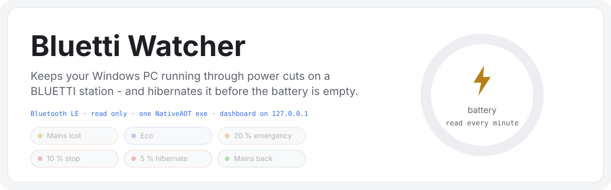
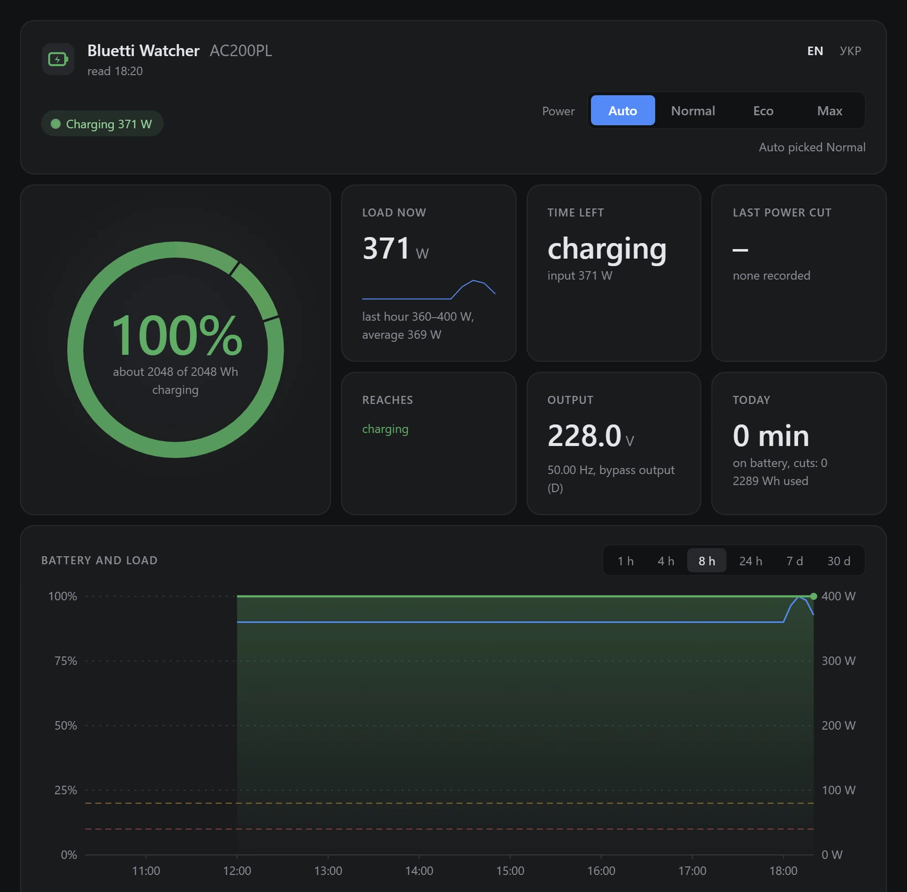
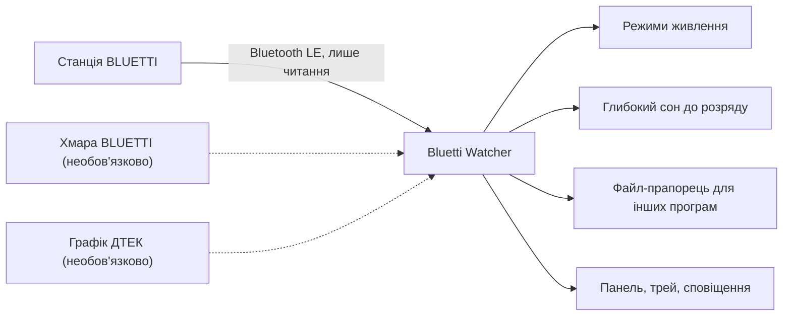
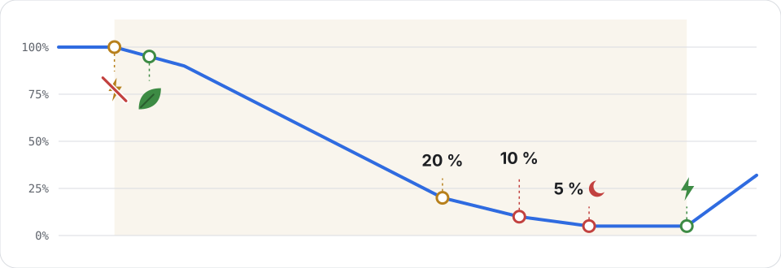
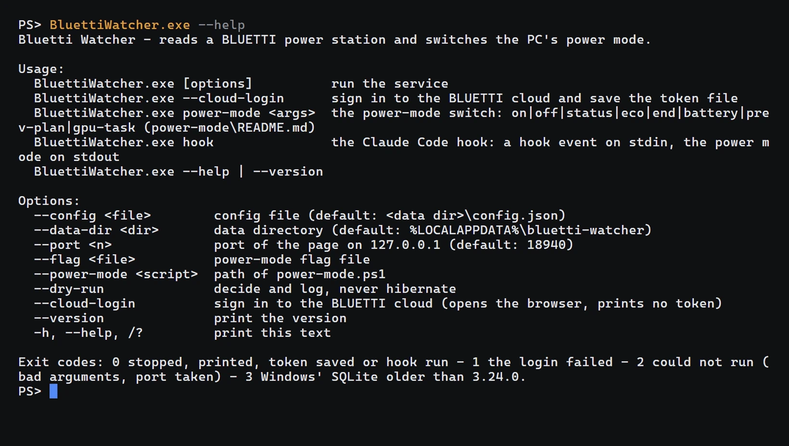
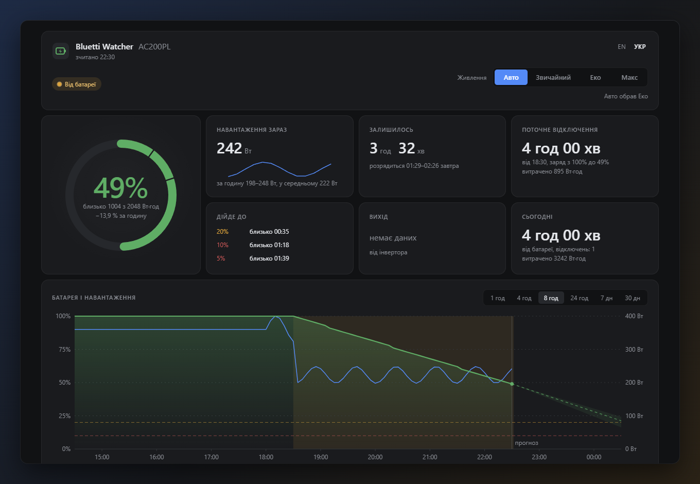
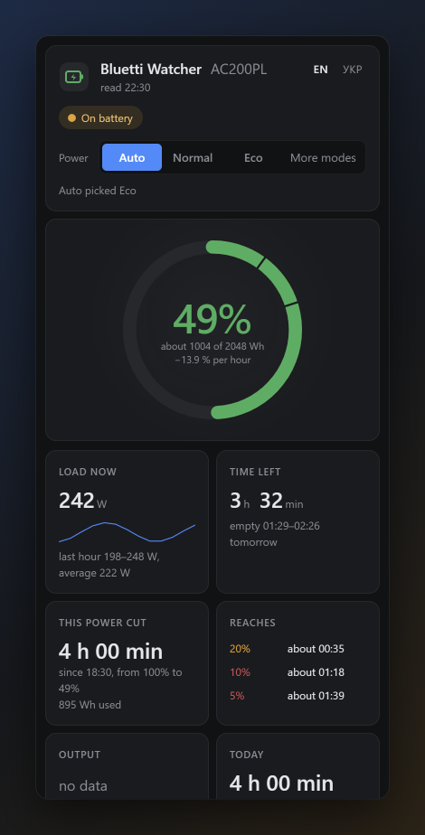

<div align="center">

<picture>
  <source media="(prefers-color-scheme: dark)" srcset="docs/media/hero-dark.svg">
  
</picture>

<h3>Тримає комп'ютер з Windows увімкненим під час відключень на станції BLUETTI і переводить його в глибокий сон, поки батарея ще не сіла.</h3>

<p>
  <a href="https://github.com/vitaliy-shatskiy/bluetti-watcher/actions/workflows/ci.yml"></a>
  <a href="https://github.com/vitaliy-shatskiy/bluetti-watcher/releases/latest"></a>
  
  <a href="LICENSE"></a>
</p>

<p><a href="README.md">English</a> · <b>Українська</b></p>

<p><a href="#встановлення">Встановлення</a> · <a href="#що-відбувається-під-час-відключення">Під час відключення</a> · <a href="#режими-живлення">Режими живлення</a> · <a href="#підтримувані-станції">Станції</a> · <a href="#часті-запитання">Запитання</a> · <a href="docs/configuration.md">Налаштування</a></p>

</div>

```powershell
pwsh -NoProfile -File install.ps1 -Mac AA:BB:CC:DD:EE:FF -CapacityWh 2048 -Apply
```

<p align="center">
  <a href="docs/media/demo.mp4"></a>
</p>

> [!IMPORTANT]
> Незалежний проєкт, не пов'язаний з BLUETTI і не схвалений нею. Завантажуйте його лише з
> [релізів цього репозиторію](https://github.com/vitaliy-shatskiy/bluetti-watcher/releases/latest).

Стаціонарний комп'ютер на зарядній станції просто тихо вимикається, коли батарея сідає. Bluetti Watcher щохвилини
зчитує станцію через Bluetooth LE. Коли зникає світло, він перемикає комп'ютер в енергоощадний режим, попереджає про
низький заряд і переводить комп'ютер у глибокий сон, поки станція ще не розрядилася; коли світло повертається, він
скасовує всі зміни. Панель на `127.0.0.1` і значок у треї показують заряд, навантаження, скільки ще вистачить і історію.



## Що ви отримуєте

- **Вбудоване зчитування через Bluetooth**: 29 моделей BLUETTI, лише читання, нічого не треба доставляти.
- **Режими живлення**: Normal, Eco, Max і ваші власні; їх обирають правила Авто або ви вручну, а кожну зміну
  скасовано, коли режим знято.
- **Безпечний глибокий сон**: рівень спрацьовує лише після двох узгоджених зчитувань, неправдоподібні стрибки
  відкинуто.
- **Час роботи від батареї за вашою станцією**: модель втрат, підігнана під ваші минулі відключення, з ймовірним
  діапазоном.
- **Панель** українською та англійською: заряд, навантаження, скільки ще вистачить, історія відключень, графіки від
  1 години до 30 днів; підходить і для телефона.
- **Значок у треї та сповіщення Windows**: світло зникло й повернулося, зміна режиму, низький заряд, збої, тривоги
  станції.
- **Необов'язково**: резерв через хмару BLUETTI, графік відключень ДТЕК (Київщина), пробудження під час відключення,
  інтеграція з Claude Code.
- **Один NativeAOT exe**, задача планувальника для поточного користувача, без вікна, служба без прав адміністратора.

## Що відбувається під час відключення

<picture>
  <source media="(prefers-color-scheme: dark)" srcset="docs/media/flow-dark.svg">
  
</picture>

| Коли (за замовчуванням) | Що відбувається |
|---|---|
| Світла немає 3 хвилини | Авто вмикає Eco: схема живлення Windows «Енергозбереження» плюс дії Eco, які ви ввімкнули |
| Заряд 20 % | Аварійний рівень: файл-прапорець каже програмам, що його читають, згортати роботу |
| Заряд 10 % | Стоп: прапорець каже critical, сигнал зберегти роботу й зупинитися |
| Заряд 7 % | Попередження про глибокий сон |
| Заряд 5 % | Комп'ютер іде в глибокий сон, коли свіже зчитування це підтверджує |
| Світло є 3 хвилини | Авто повертає Normal; усе, що змінив Eco, відновлено |

Усі пороги налаштовуються ([configuration.md](docs/configuration.md#mains-and-battery-levels)). За великого виміряного
розряду пороги піднімаються, щоб комп'ютер усе одно встиг заснути. Повні правила - у [docs/design.md](docs/design.md)
(англійською).

## Встановлення

Потрібні Windows 10 або 11 x64 з адаптером Bluetooth LE, PowerShell 7 (`pwsh`) і Chrome або Edge для ярлика панелі.
Служба використовує вбудований у Windows SQLite (`winsqlite3.dll`) версії 3.24.0 або новішої; зі старішою вона не
запускається, а `service.log` називає знайдену версію.

1. Завантажте `bluetti-watcher-<version>-win-x64.zip` і його `.sha256` з
   [останнього релізу](https://github.com/vitaliy-shatskiy/bluetti-watcher/releases/latest), звірте хеш і розпакуйте:

   ```powershell
   (Get-FileHash .\bluetti-watcher-*-win-x64.zip).Hash   # має збігатися з хешем у файлі .sha256
   ```

2. Дізнайтеся Bluetooth-адресу станції (застосунок BLUETTI або Параметри Windows > Bluetooth) та її ємність у Вт·год
   (з характеристик; з неї рахується, скільки ще вистачить).
3. У PowerShell 7, у розпакованій теці:

   ```powershell
   pwsh -NoProfile -File install.ps1 -Mac AA:BB:CC:DD:EE:FF -CapacityWh <Wh>          # пробний запуск: кожен крок і що йому заважає
   pwsh -NoProfile -File install.ps1 -Mac AA:BB:CC:DD:EE:FF -CapacityWh <Wh> -Apply   # встановити
   ```

Інсталятор створює `%LOCALAPPDATA%\bluetti-watcher` (`bin\`, `config.json`, `station.db`, `service.log`), реєструє
задачу входу `BluettiWatcher` (поточний користувач, без підвищених прав), запускає її і чекає відповіді `/api/health`,
реєструє задачу пробудження (вимкнену) і додає ярлик `Bluetti Watcher` на робочий стіл і в меню «Пуск».

Дії режимів живлення, яким потрібні права адміністратора (служби, задачі планувальника, обмеження потужності й профілі
NVIDIA), виконує **адмін-брокер** - задача SYSTEM, що робить лише те, що названо в її списку дозволів. Запустіть
встановлення з PowerShell від імені адміністратора, і воно налаштує й брокер; зі звичайного воно встановить службу і
назве крок, що лишився:

```powershell
pwsh -NoProfile -File install.ps1 -Broker -Apply   # від імені адміністратора, у розпакованій теці релізу
```

Без брокера служба працює; про це повідомляють лише дії, яким він потрібен.

## Користування

- **Панель**: ярлик `Bluetti Watcher` або `http://127.0.0.1:18940/`. Панель «Режими живлення» обирає Авто чи режим,
  редагує режими й правила і вмикає або вимикає глибокий сон.
- **Значок у треї**: заряд цифрами над смужкою, зелений від мережі, бурштиновий від батареї, сірий, коли свіжого
  зчитування немає. Підказка показує вати, режим і скільки ще вистачить; клік відкриває Авто, кожен режим, «Відкрити
  панель» і «Закрити значок» (ховає значок до перезапуску служби; служба працює далі). Меню, підказка й сповіщення
  мовою, яку востаннє вибрали на сторінці (англійська або українська).
- **Сповіщення**: тости Windows про зникнення й повернення світла, зміну режиму, низький заряд, збої дій, адмін-брокер,
  старіший за службу, а також несправності, попередження й перегрів станції. Кожну групу можна вимкнути на панелі або в
  [`notifications.json`](docs/configuration.md#notifications-notificationsjson). Без значка (`"tray": false` або
  `--no-tray`) сповіщень немає.
- **Файл-прапорець** `%ProgramData%\BluettiWatcher\power-mode.json`: поточний режим і рівень заряду для інших програм
  ([power-mode/README.md](power-mode/README.md)).
- **Командний рядок**: `BluettiWatcher.exe --help`, `--version`, `power-mode status`
  ([усі команди](docs/configuration.md#command-line)).

<p align="center">
  <a href="docs/demos/cli.mp4"></a>
</p>

| Українською, комп'ютер | Англійською, телефон |
|---|---|
|  |  |

## Режими живлення

Режим живлення - це іменований список дій над цим комп'ютером. Normal, Eco і Max вбудовані; власні додаються
на панелі або через [API](docs/api.md#power-modes-modesengine--v2). **Авто** обирає режим за правилами, які перевіряє
по черзі: світла немає або є вже певний час, заряд нижче рівня, планове відключення за кілька хвилин (модуль ДТЕК),
часове вікно. Режим, обраний вручну, тримається, доки ви знову не оберете Авто.

Дії, які може містити режим:

- схема живлення, максимальний стан процесора і його прискорення, час до вимкнення екрана;
- частота оновлення і яскравість екрана;
- обмеження потужності й профіль драйвера відеокарти NVIDIA;
- служби і задачі планувальника;
- закриття програм і Phone Link;
- пара команд із `config.json` (наприклад, призупинити резервне копіювання на вході й відновити на виході);
- вимкнення RGB-підсвітки через [OpenRGB](https://openrgb.org/), обраний профіль повертається на виході;
- спостерігач, що записує в журнал, що тримає відеокарту на повній частоті.

Обмеження й профіль відеокарти, служби, задачі, які не дозволяють користувачеві їх змінювати, і програми з підвищеними
правами проходять через адмін-брокер, який діє лише на те, що назване в його списку дозволів
(`BluettiWatcher.exe --broker-allow`, від імені адміністратора).

Кожну зміну записано в журнал і скасовано, коли режим знято, хіба що ви тим часом змінили це налаштування вручну: тоді
воно лишається таким, як ви його встановили. Вбудований Eco використовує схему «Енергозбереження», а решту дій має
вимкненими. `"modes": { "engine": "legacy" }` залишає старий фіксований еко
([configuration.md](docs/configuration.md#power-mode-and-actions)).

## Підтримувані станції

| Сімейство | Моделі | Через Bluetooth |
|---|---|---|
| IoT V1 | AC200PL (перевірено), AC200L, AC200M, AC300, AC500, EB3A, EP500, EP500P | так |
| IoT V2 | AC2A, AC2P, AC50B, AC60, AC60P, AC70, AC70P, AC180, AC180T, AC180P, AP300, EL10, EL30V2, EL100V2, Handsfree 1, PR30V2, PR100V2 | так |
| IoT V2, лише рівень заряду | EP600, EP760, EP800, EP2000 | ні: Bluetooth не розрізняє там мережу й батарею, їх читає резерв через хмару |

Укажіть свою модель у `type` у `config.json`. На залізі перевірено лише AC200PL. Станцію, що шифрує Bluetooth-з'єднання,
розпізнано (`/api/health` показує `bluetoothEncrypted: true`); до неї не підключаються знову до перезапуску служби, а
читає її резерв через хмару, якщо він увімкнений. Карти регістрів: [docs/bluetti-protocol.md](docs/bluetti-protocol.md).
Звіт допоможе: [підтримка станції](https://github.com/vitaliy-shatskiy/bluetti-watcher/issues/new?template=station_support.yml).

## Додаткові модулі

- **Резерв через хмару** (неофіційний, лише читання): коли Bluetooth не відповідає, зчитування береться з поточного
  стану в хмарі BLUETTI, а прогалини в історії заповнюються з її 5-хвилинної історії. Увійдіть на панелі («Увійти в
  хмару BLUETTI») або один раз через `BluettiWatcher.exe --cloud-login`. Кнопки «Джерело даних» обирають Авто
  (Bluetooth, потім хмара), лише Bluetooth або лише хмару. Може перестати працювати, якщо BLUETTI змінить свій API.
  [Докладно](docs/design.md#4-cloud-fallback).
- **Модуль ДТЕК** (Київщина, вимкнений за замовчуванням): наступне планове відключення для вашої черги, погодинна сітка
  на сьогодні й завтра, звірена з власним зчитуванням мережі станцією, і чи вистачить батареї. Вмикається так:
  `"dtekWatcher": { "enabled": true, "queues": ["GPV1.1"] }`.
  [Докладно](docs/design.md#11-dtek-module-planned-outages-kyiv-region).
- **Пробудження під час відключення** (вимкнене за замовчуванням): комп'ютер, що заснув під час відключення,
  прокидається кожні `wakeEveryMinutes`, щоб перевірити, чи є світло; біля порожньої батареї - ніколи. Перед увімкненням
  один раз виконайте перевірку нижче. [Докладно](docs/design.md#8-wake-during-a-cut).
- **Інтеграція з Claude Code**: `BluettiWatcher.exe hook` повідомляє кожній сесії Claude Code режим живлення й рівень
  заряду, щоб вона зберігала роботу й уникала важких задач під час відключення.
  [integrations/claude-code](integrations/claude-code/README.md).

<details>
<summary>Перевірка пробудження: один раз перед тим, як задати <code>wakeEveryMinutes</code></summary>

Зі звичайного (не адміністраторського) PowerShell після встановлення:

```powershell
$t = Get-ScheduledTask -TaskName BluettiWatcherWake; $t.Triggers[0].StartBoundary = (Get-Date).AddMinutes(4).ToString('s'); $t.Triggers[0].Enabled = $true; $t.Settings.Enabled = $true; Set-ScheduledTask -InputObject $t | Out-Null; powercfg /waketimers; shutdown /h
```

`powercfg /waketimers` має показати задачу до того, як комп'ютер засне, а приблизно за 4 хвилини комп'ютер має
прокинутися сам (`powercfg /lastwake` називає джерело; `Disable-ScheduledTask -TaskName BluettiWatcherWake` вимикає
задачу). Якщо не прокидається, пробудження RTC з глибокого сну вимкнене в прошивці або «Дозволити таймери пробудження»
вимкнено в схемі живлення. Якщо прокидається: задайте `"wakeEveryMinutes": 45` у `config.json` і перезапустіть задачу.

</details>

## Безпека та приватність

- **Станцію лише читають.** Зчитувач Bluetooth будує один вид запиту - читання Modbus (функція 0x03) - і не записує
  нічого, крім цього запиту й підписки на сповіщення. Хмарний клієнт не має жодної команди керування.
- **Лише локально.** HTTP API слухає `127.0.0.1` і відхиляє будь-який `Host`, крім `127.0.0.1:<port>` або
  `localhost:<port>`. Кожен маршрут запису вимагає заголовка `X-Station: 1` і жодного чужого `Origin`, а інші
  вебсторінки такого надіслати не можуть ([api.md](docs/api.md#request-rules)).
- **Вимикачі.** «Гібернацію вимкнено» на панелі «Режими живлення» зупиняє глибокий сон. `--dry-run` або
  `"dryRun": true` записує в журнал кожну команду режиму живлення й глибокий сон замість їх виконання.
- **Нічого не виходить за межі комп'ютера**, доки ви не ввімкнете модуль:
  - Резерв через хмару: `sso.bluettipower.com` (вхід, оновлення токена) і `gw.bluettipower.com` (список пристроїв,
    поточний стан, до 40 запитів історії на добу). Токен лежить у теці даних і ніколи не потрапляє в журнал.
  - Модуль ДТЕК: публічний набір даних на `raw.githubusercontent.com`; з `"site": true` ще й сайт розподільника, на
    умовах цього сайту; ваша адреса йде туди, лише якщо ви задали `city`, `street` і `house`.

Повідомити про вразливість: [SECURITY.md](SECURITY.md).

## Часті запитання

<details>
<summary><b>Windows попереджає про завантаження, або PowerShell не запускає <code>install.ps1</code> як непідписаний.</b></summary>

Реліз не підписаний цифровим підписом. Порівняйте `(Get-FileHash <zip>).Hash` із файлом `.sha256` з того самого релізу,
потім розблокуйте розпаковану теку: `Get-ChildItem -Recurse | Unblock-File`.

</details>

<details>
<summary><b>Чи змінює він якісь налаштування станції?</b></summary>

Ні. Через Bluetooth ідуть лише запити читання, а хмарний клієнт не має жодної команди керування.

</details>

<details>
<summary><b>Bluetooth не відповідає.</b></summary>

Тримайте станцію в межах досяжності й закрийте застосунок BLUETTI на телефоні: він може тримати з'єднання.
`service.log` називає перший пропуск, перехід у стан «станція мовчить», кожен 15-й пропуск після нього і крок, на
якому завис повільний конект. Прогалини закриває резерв через хмару.

</details>

<details>
<summary><b>Як зупинити глибокий сон просто зараз?</b></summary>

Оберіть «Гібернацію вимкнено» на панелі «Режими живлення»; це діє одразу. Зі старим рушієм (`legacy`) натомість
створіть порожній файл `no-hibernate` у `%LOCALAPPDATA%\bluetti-watcher`.

</details>

<details>
<summary><b>Диспетчер завдань показує, що служба майже не займає пам'яті. Це правда?</b></summary>

Частково. Після кожного опитування служба віддає свої сторінки Windows (`trimWorkingSet`, увімкнено за замовчуванням),
тому стовпець «Пам'ять» (приватний робочий набір) лишається малим; виділена пам'ять не змінюється, а сторінки
повертаються на наступному опитуванні. `"trimWorkingSet": false` вимикає це.

</details>

<details>
<summary><b>Інші бренди (EcoFlow, Jackery, ...)?</b></summary>

Ні. Зчитувач розуміє лише протокол BLUETTI.

</details>

## Налаштування

`%LOCALAPPDATA%\bluetti-watcher\config.json`; обов'язковий лише `mac`. Кожен ключ і його значення за замовчуванням:
[docs/configuration.md](docs/configuration.md). HTTP API: [docs/api.md](docs/api.md). Після зміни перезапустіть задачу:

```powershell
Stop-ScheduledTask BluettiWatcher; Start-ScheduledTask BluettiWatcher
```

## Оновлення та видалення

Щоб оновити, запустіть `install.ps1 -Apply` з теки нового релізу. `config.json`, історія й токен хмари лишаються; новий
exe підміняється за секунди, а якщо перевірка стану не пройде, повертається попередній. З адмін-брокером також
запустіть `install.ps1 -Broker -Apply` від імені адміністратора: брокер працює зі своєю копією exe, а `/api/health` і
трей кажуть, коли цей крок потрібен. Що змінилося: [CHANGELOG.md](CHANGELOG.md).

<details>
<summary>Видалення</summary>

Коли є світло, у такому порядку:

1. На панелі «Режими живлення» оберіть **Normal**, щоб усе, що змінив режим, було відновлено.
2. Зупиніть службу й видаліть її задачі та файли:

```powershell
Disable-ScheduledTask -TaskName BluettiWatcher | Out-Null
Stop-ScheduledTask -TaskName BluettiWatcher
Get-Process BluettiWatcher, BluettiWatcherService -ErrorAction SilentlyContinue | Wait-Process -Timeout 30
pwsh -NoProfile -File "$env:LOCALAPPDATA\bluetti-watcher\power-mode\power-mode.ps1" off   # скидає прапорець; рушій legacy: відновлює свій еко
Unregister-ScheduledTask -TaskName BluettiWatcher -Confirm:$false
pwsh -NoProfile -File install.ps1 -RemoveWake -Apply                                    # з теки релізу
Remove-Item -Recurse "$env:LOCALAPPDATA\bluetti-watcher", "$env:ProgramData\BluettiWatcher"
```

3. Якщо є адмін-брокер або старі задачі відеокарти - з PowerShell від імені адміністратора:

```powershell
Unregister-ScheduledTask -TaskName BluettiWatcherBroker -Confirm:$false -ErrorAction SilentlyContinue
Get-ScheduledTask -TaskName 'BluettiWatcherEco*' -ErrorAction SilentlyContinue | Unregister-ScheduledTask -Confirm:$false
Remove-Item -Recurse "$env:ProgramFiles\BluettiWatcher", "$env:ProgramData\BluettiWatcherBroker" -ErrorAction SilentlyContinue
```

4. Видаліть ярлики `Bluetti Watcher`.

`power-mode.ps1 off` друкує `power mode: normal` і по рядку на кожну відновлену річ; рядок, що починається з `warn:`
або `note:`, означає, що щось ще не повернуто, - запустіть його ще раз. Якщо в `config.json` задано нестандартні назви
`powerMode`, спершу задайте `POWER_MODE_FILE`, `POWER_MODE_MUTEX` і `POWER_MODE_TASK_PREFIX`
([README power-mode](power-mode/README.md#configuration)).

</details>

## Збирання з коду

```powershell
git clone https://github.com/vitaliy-shatskiy/bluetti-watcher.git
cd bluetti-watcher
pwsh -NoProfile -File install.ps1 -Mac AA:BB:CC:DD:EE:FF -CapacityWh <Wh> -Apply   # публікує NativeAOT, потім встановлює
```

Потрібні .NET SDK з `global.json` і, для NativeAOT, компонувальник MSVC (Visual Studio Build Tools, «Desktop
development with C++»); `-Fallback` збирає без нього урізаний однофайловий exe. Тести й розробка:
[CONTRIBUTING.md](CONTRIBUTING.md) (англійською).

---

[Як долучитися](CONTRIBUTING.md) · [Безпека](SECURITY.md) · [Зміни](CHANGELOG.md)

MIT, див. [LICENSE](LICENSE). Не пов'язаний з BLUETTI і не схвалений нею.
